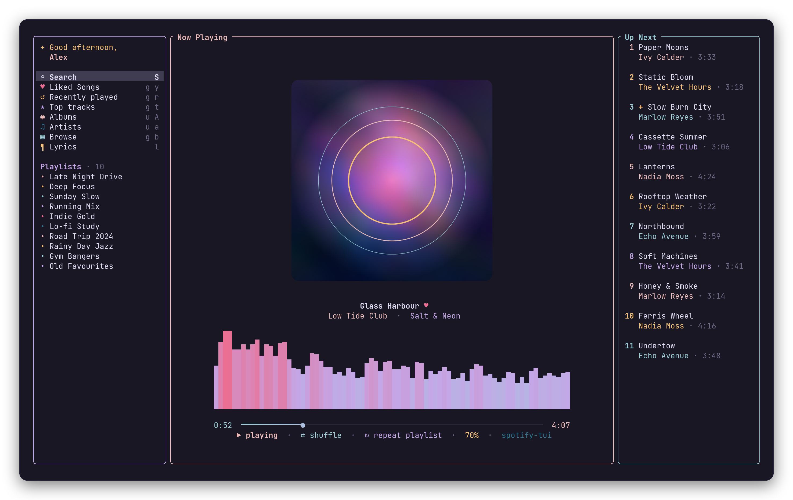
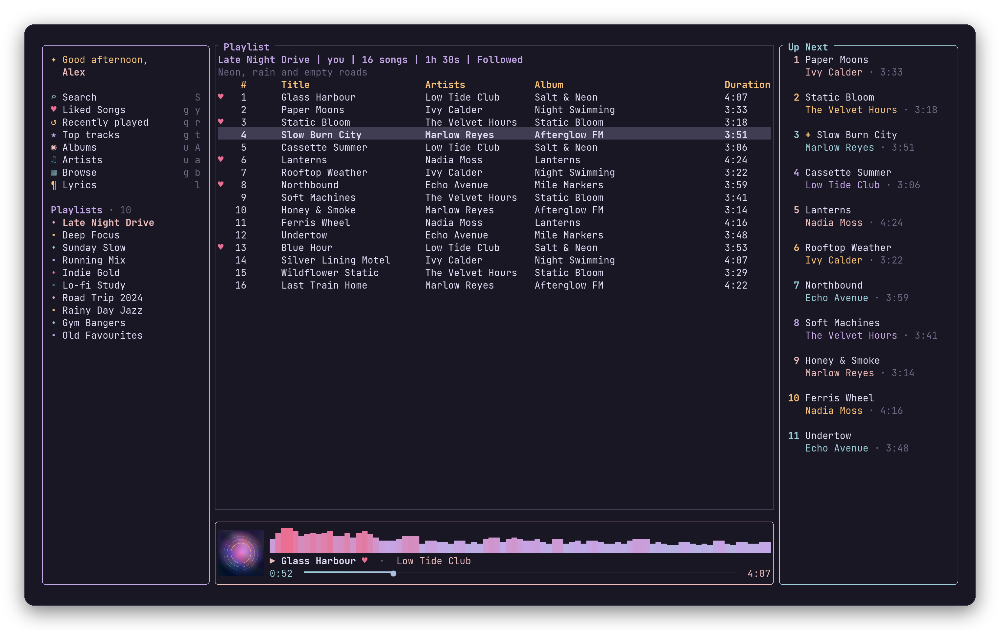
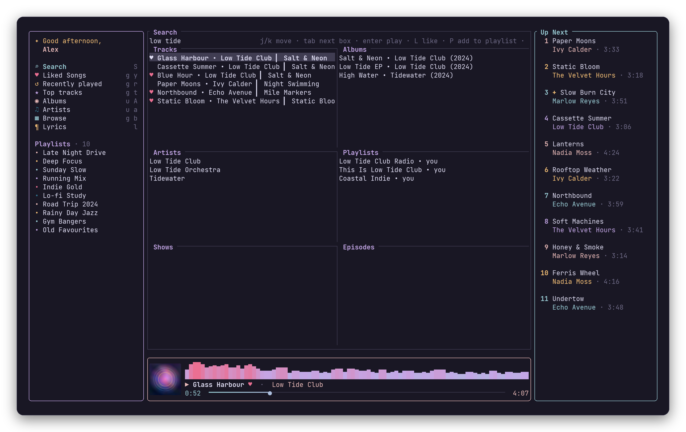
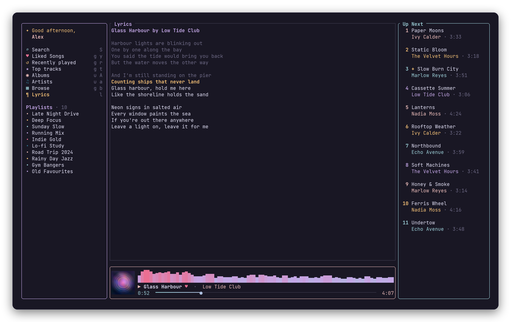
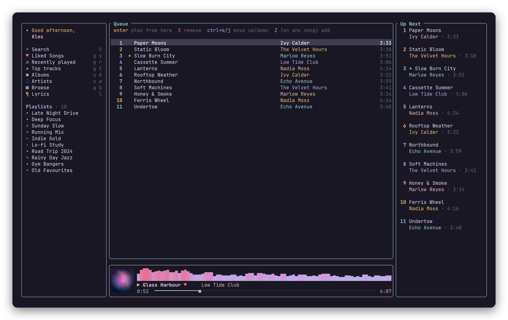
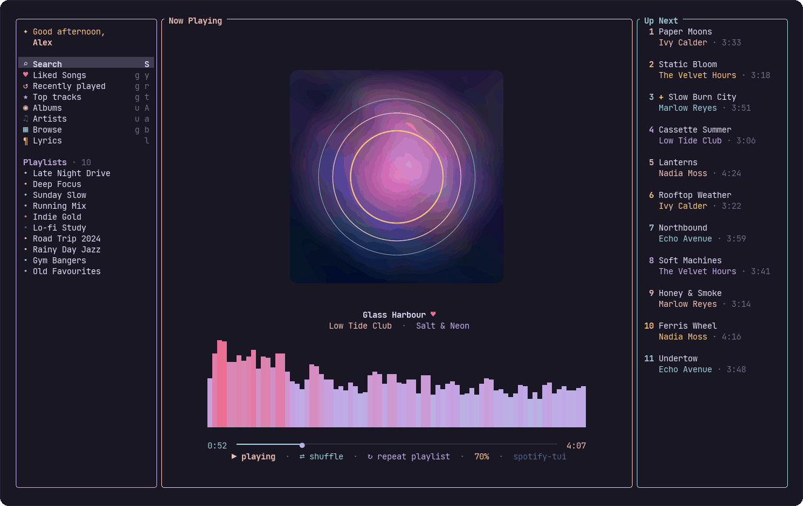

<h1 align="center">spotify-tui</h1>

<p align="center">
  Spotify in your terminal: album art, a live audio wave, synced lyrics and vim keys.
</p>

<p align="center">
  <a href="#installation">Installation</a> ·
  <a href="#usage">Usage</a> ·
  <a href="docs/commands.md">Keys</a> ·
  <a href="docs/config.md">Configuration</a>
</p>

## Description

spotify-tui is a Spotify player that lives in a terminal window. It plays music
itself, so you don't need the Spotify app open, and it shows up as a speaker
in Spotify Connect, so your phone can control it too. Or the other way round:
it can control Spotify running on your phone or another computer.

The screen has three columns. On the left are your library and playlists. In
the middle is the song that's playing, with its cover, an audio wave and the
progress bar, or whatever page you've opened. On the right is what plays next.
It comes in the Rosé Pine colours and is driven entirely from the keyboard.

It is built on [spotify-player](https://github.com/aome510/spotify-player),
with a new layout and a number of fixes. A Spotify Premium account is
required.

## Features

- **Plays in the terminal.** Music streams straight into the app through
  [librespot](https://github.com/librespot-org/librespot), and the app shows up
  as a device in Spotify Connect.
- **Big album art.** Sharp images in kitty, Ghostty, WezTerm and iTerm2, and
  block characters in any other terminal.
- **Live audio wave.** It moves with the music the app is playing, not with
  other sound on your computer.
- **Synced lyrics.** The current line is highlighted as the song plays.
- **Up Next and an editable queue.** You can play from any song in the queue,
  remove songs and reorder them.
- **Search** for songs, artists, albums, playlists and podcasts from any page
  with `S`.
- **Playlists and likes.** One key each to like a song, add it to a playlist,
  remove it, or create a playlist. You can also reorder your own playlists.
- **Vim keys.** `j`/`k` with counts, `gg`/`G`, `g`-prefixed jumps, and `/` to
  filter any list.
- **Rosé Pine.** The `rose-pine`, `rose-pine-moon` and `rose-pine-dawn` themes
  are built in, and you can [make your own](docs/config.md#themes).
- **Recovers on its own.** It reconnects after the computer sleeps or the
  network drops, and carries on where the song was. On networks that block
  Spotify's port it falls back to 443.
- **Fits in with your desktop.** Media keys and MPRIS on Linux, a launcher entry
  for app menus and rofi, a [command line](docs/commands.md#command-line) for
  scripts, and desktop notifications as an option.

## Pictures

<table>
  <tr>
    <td></td>
    <td></td>
  </tr>
  <tr>
    <td align="center">Now playing</td>
    <td align="center">A playlist</td>
  </tr>
  <tr>
    <td></td>
    <td></td>
  </tr>
  <tr>
    <td align="center">Search</td>
    <td align="center">Lyrics</td>
  </tr>
  <tr>
    <td></td>
    <td></td>
  </tr>
  <tr>
    <td align="center">Queue</td>
    <td></td>
  </tr>
</table>

The songs, artists and cover in these pictures are made up.
`scripts/screenshots` renders them from the app's real drawing code.

## Preview

<p align="center">
  
</p>

## Installation

### Requirements

- A **Spotify Premium** account.
- **Linux.** This is where it's built and tested. macOS should build from
  source, but it hasn't been tried.
- **Rust** (stable), from [rustup.rs](https://rustup.rs).
- The audio, TLS and D-Bus libraries:

  ```sh
  # Debian, Ubuntu
  sudo apt install build-essential pkg-config libssl-dev libasound2-dev libdbus-1-dev

  # Fedora
  sudo dnf install gcc pkgconf-pkg-config openssl-devel alsa-lib-devel dbus-devel

  # Arch
  sudo pacman -S base-devel openssl alsa-lib dbus
  ```

- For sharp album art, a terminal with image support: kitty, Ghostty, WezTerm
  or iTerm2.

### Build and install

```sh
git clone https://github.com/Srindot/spotify-tui.git
cd spotify-tui
make install
```

This installs the `spotify_tui` command to `~/.local/bin`, together with a
launcher entry and an icon, so it also shows up in app menus and rofi. The
first build takes a few minutes.

| Option                            | What it does                                                  |
| --------------------------------- | ------------------------------------------------------------- |
| `make install TERMINAL=alacritty` | the launcher opens it in another terminal (default: `kitty`)  |
| `make install PREFIX=/usr/local`  | install for every user (run with `sudo`)                      |
| `make install FEATURES="image notify"` | add [optional features](#optional-features)              |
| `make uninstall`                  | remove it again                                               |

Make sure `~/.local/bin` is on your `PATH`. Without `make`, you can install
straight from the repository instead:

```sh
cargo install --locked --git https://github.com/Srindot/spotify-tui spotify_player --features image
```

### Optional features

These are added with `FEATURES="..."`:

| Feature    | Adds                                                       |
| ---------- | ---------------------------------------------------------- |
| `image`    | album art (on by default with `make`)                      |
| `notify`   | a desktop notification when the song changes               |
| `fzf`      | fuzzy matching when filtering lists with `/`               |
| `sixel`    | album art in sixel terminals such as foot                  |
| `daemon`   | `spotify_tui -d` keeps playing in the background, no window |
| `pulseaudio-backend`, `alsa-backend`, ... | another audio output (default: rodio) |

## Usage

```sh
spotify_tui
```

### First run

Spotify's login page opens in your browser twice: once for your library and
once for playback. Approve both. Your login is saved in
`~/.cache/spotify-player`, so this only happens once.

### Keys

These are the main keys. Press `?` in the app to see all of them, or read
[docs/commands.md](docs/commands.md).

| Key               | Does                                    |
| ----------------- | --------------------------------------- |
| `space`           | play / pause                            |
| `n` / `p`         | next / previous song                    |
| `+` / `-`         | volume                                  |
| `>` / `<`         | seek forward / back                     |
| `C-s` / `C-r`     | shuffle / repeat                        |
| `j` `k`, `enter`  | move, play or open                      |
| `S`               | search                                  |
| `/`               | filter the list you're looking at       |
| `L` / `C-l`       | like the selected / the playing song    |
| `P` / `X`         | add to a playlist / remove from it      |
| `Z`               | add to the queue                        |
| `z`               | the queue                               |
| `l`               | lyrics                                  |
| `g y`, `g r`, `g t` | liked songs, recently played, top tracks |
| `g l`             | home                                    |
| `D`               | choose the device to play on            |
| `T`               | change the theme                        |
| `backspace`       | back                                    |
| `q`               | quit                                    |

The menu entries in the left column show their keys too.

### Configuration

Settings live in `~/.config/spotify-player`. The `app.toml` file is created
with the defaults on first run. A few things people often change:

```toml
theme = "rose-pine-moon"     # or rose-pine, rose-pine-dawn
ap_port = 443                # on networks that block Spotify's port
seek_duration_secs = 10

[device]
name = "spotify-tui"         # the name in Spotify Connect
volume = 70
```

Every option is in [docs/config.md](docs/config.md), and you can change any key
in `keymap.toml`. If Spotify starts answering "too many requests", it is
because the built-in client ID is shared with other users. Register your own:
see [Client id command](docs/config.md#client-id-command).

### Logs

If something goes wrong, the log is in
`~/.cache/spotify-player/spotify-player-*.log`. You can also read it inside
the app with `g o`.

## Credits

- [spotify-player](https://github.com/aome510/spotify-player) by Thang Pham
  is the player this is built on: the Spotify client, the pages, the command
  line and most of what's under the hood.
- [librespot](https://github.com/librespot-org/librespot) does the streaming.
  A copy of its Connect module is in `vendor/`, with queue editing added
  (see [QUEUE.md](vendor/librespot-connect/QUEUE.md)).
- [ratatui](https://github.com/ratatui/ratatui),
  [ratatui-image](https://github.com/benjajaja/ratatui-image) and
  [rspotify](https://github.com/ramsayleung/rspotify) are the other main
  libraries.
- The colours are [Rosé Pine](https://rosepinetheme.com).
- The name and the idea come from the original
  [spotify-tui](https://github.com/Rigellute/spotify-tui) by Alexander Keliris
  and from [ncspot](https://github.com/hrkfdn/ncspot).

This project isn't affiliated with or endorsed by Spotify.

## License

MIT. See [LICENSE](LICENSE).
